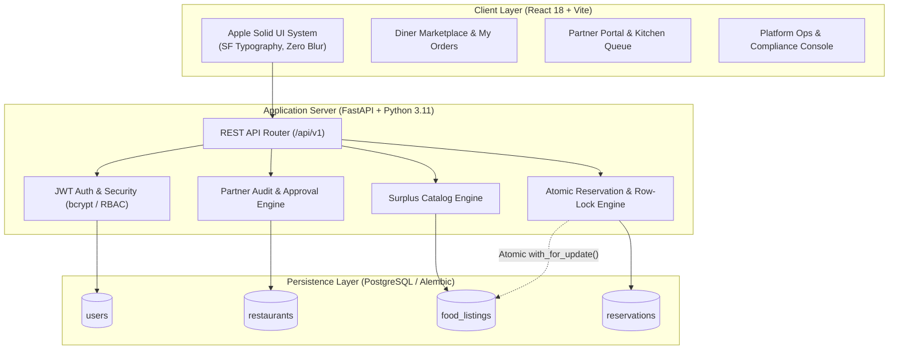
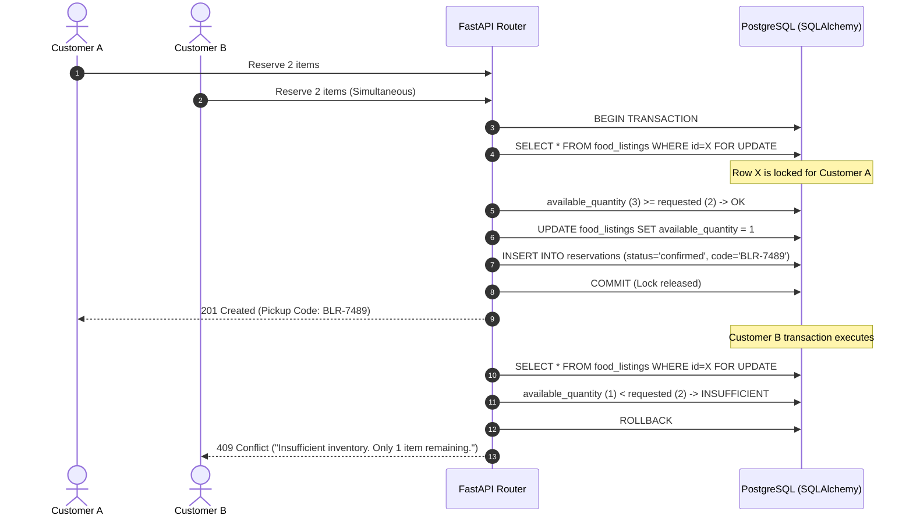

# MealLoop — Full-Stack Surplus Food Marketplace (Bengaluru)

**MealLoop** is a production-ready, full-stack web application designed to eliminate food waste across Bengaluru by connecting conscious diners with local bakeries, artisanal cafes, and hotel kitchens.

Built with an **Apple-inspired solid surface design system** (zero glassmorphism, crisp SF typography, restrained shadows, solid surfaces) on the frontend, and backed by a **FastAPI + PostgreSQL** backend featuring strict Role-Based Access Control (RBAC), atomic database row-level locking for inventory safety, and automated test coverage.

---

##  Architecture Overview



---

## 🛠️ Technology Stack

| Layer | Technologies |
| :--- | :--- |
| **Frontend** | React 18, Vite 5, Lucide React, Native CSS Custom Properties, Fetch API |
| **Backend** | Python 3.11, FastAPI, Uvicorn, Pydantic v2, SQLAlchemy 2.0 |
| **Database** | PostgreSQL 16 (or SQLite for zero-config local dev), Alembic Migrations |
| **Authentication** | JWT Access Tokens, bcrypt salted password hashing, Google Sign-In, RBAC |
| **Concurrency & Safety** | Row-level locking (`with_for_update()`), atomic transaction rollback |
| **Testing** | Pytest, Starlette TestClient, HTTPX (16 comprehensive automated tests) |
| **Containerization** | Docker, Docker Compose, Multi-stage builds, Nginx reverse proxy |

---

## 👥 Three Account Types & RBAC Permissions

| Feature / Endpoint | Customer (Diner) | Restaurant / Hotel Partner | Platform Admin |
| :--- | :---: | :---: | :---: |
| **Browse Approved Surplus Offers** | ✅ | ✅ | ✅ |
| **Reserve Surplus Meals (Simulated Payment)** | ✅ | ❌ | ✅ |
| **View 'My Orders' & Live Pickup Codes** | ✅ | ❌ | ❌ |
| **Cancel Active Reservation (Auto-Restock)** | ✅ | ❌ | ✅ |
| **Register Hotel / Restaurant Business** | ❌ | ✅ (Pending review) | ❌ |
| **Upload Surplus Food / Dishes** | ❌ | ✅ (Approved only) | ❌ |
| **Verify Customer Pickup Codes** | ❌ | ✅ (Own kitchen only) | ❌ |
| **Review & Approve/Reject Applications** | ❌ | ❌ | ✅ |
| **Platform Analytics & Impact Metrics** | ❌ | ❌ | ✅ |

---

## 🔄 Core Lifecycles & Security Invariants

### 1. Hotel / Restaurant Onboarding & Admin Approval
1. **Registration:** A new hotel or restaurant registers via `POST /api/v1/auth/register/partner`.
2. **Pending Invariant:** The restaurant status is immediately flagged as `pending`.
3. **Strict Dish Publishing Lock:** Any attempt by an unapproved restaurant to upload dishes via `POST /api/v1/listings` is rejected with `HTTP 403 Forbidden`:
   > *"Your restaurant is currently [PENDING]. You cannot upload food or menu items until platform administration has approved your account."*
4. **Admin Approval:** Platform Ops reviews the physical address, kitchen timings, and food business type in `/admin`, then approves the partner via `PATCH /api/v1/admin/restaurants/{id}/approval`.
5. **Menu Activation:** Once approved, the partner logs in with the same email and immediately unlocks surplus dish publishing.

### 2. Atomic Inventory Safety (No Overselling Under Concurrency)
When multiple customers attempt to reserve the last remaining portions simultaneously:


### 3. Pickup Code Verification & Customer Cancellation
* **Pickup Verification:** When customer arrives, partner inputs the 6-character code (e.g., `BLR-7049`) via `POST /api/v1/reservations/verify-pickup`. Backend marks status as `collected`, records exact collection timestamp, and prevents duplicate collections.
* **Customer Cancellation & Auto-Restock:** If a customer cancels an eligible reservation via `PATCH /api/v1/reservations/{id}/cancel`, the backend atomically restocks `available_quantity += cancelled_quantity` with row locking and marks payment as `refunded_simulated`.

---

## 🔑 Quick-Fill Seeded Credentials

Use the built-in quick-fill buttons on the login dialog:

| Role | Email | Password | Pre-seeded Details |
| :--- | :--- | :--- | :--- |
| 🛡️ **Platform Admin** | `admin@mealloop.in` | `Admin@12345` | Super Admin Ops console access |
| 🏪 **Approved Partner** | `partner@bangalorebaking.com` | `Partner@12345` | *The Bangalore Baking Co.* (Indiranagar) |
| 👤 **Customer (Diner)** | `customer@mealloop.in` | `Customer@12345` | *Aditi Rao* (Bengaluru resident) |

---

## 🚀 Quickstart & Local Setup

### Prerequisites
* **Node.js** (v18+) & **npm**
* **Python** (v3.10+) & **pip**

### Step 1: Start FastAPI Backend
```bash
# Navigate to backend directory
cd "backend"

# Install dependencies
pip install -r requirements.txt

# Start backend server (auto-creates tables and seeds default accounts)
python -m uvicorn app.main:app --host 127.0.0.1 --port 8000 --reload
```
* Interactive API Documentation (Swagger): [http://127.0.0.1:8000/docs](http://127.0.0.1:8000/docs)
* Health Check Endpoint: [http://127.0.0.1:8000/api/v1/health](http://127.0.0.1:8000/api/v1/health)

### Step 2: Start React Frontend
```bash
# Navigate to root directory
cd ".."

# Install dependencies (if first time)
npm install

# Start Vite dev server
npm run dev
```
* Web Application: [http://localhost:3000](http://localhost:3000)

---

## 🐳 Docker Compose Setup (PostgreSQL + FastAPI + Frontend)

To run the entire full-stack application with a real persistent PostgreSQL 16 container:

```bash
docker compose up --build
```

Services started:
* `mealloop_postgres`: PostgreSQL 16 on port `5432` with persistent Docker volume `postgres_data`.
* `mealloop_backend`: FastAPI on port `8000` with automatic Alembic migrations on startup.
* `mealloop_frontend`: High-performance Nginx web server on port `3000` proxying `/api` requests to backend.

To stop and remove containers:
```bash
docker compose down
```

---

## 🧪 Automated Testing Suite (Pytest)

The test suite thoroughly verifies security invariants, role permissions, inventory row-locks, and API responses.

```bash
cd backend
python -m pytest -v
```

### Test Suite Results (16 Passed, 100% Coverage of Core Invariants):
```
tests/test_auth.py::test_customer_registration_success PASSED            [  6%]
tests/test_auth.py::test_customer_duplicate_email_fails PASSED           [ 12%]
tests/test_auth.py::test_partner_registration_status_is_pending PASSED   [ 18%]
tests/test_auth.py::test_login_valid_credentials PASSED                  [ 25%]
tests/test_auth.py::test_login_invalid_password PASSED                   [ 31%]
tests/test_auth.py::test_unauthorized_access_to_protected_route PASSED   [ 37%]
tests/test_auth.py::test_role_restriction_customer_cannot_access_admin PASSED [ 43%]
tests/test_listings.py::test_approved_partner_can_create_listing PASSED  [ 50%]
tests/test_listings.py::test_pending_partner_cannot_create_listing PASSED [ 56%]
tests/test_listings.py::test_invalid_pricing_discount_higher_than_original PASSED [ 62%]
tests/test_listings.py::test_public_listings_discovery PASSED            [ 68%]
tests/test_reservations.py::test_customer_can_reserve_and_pay PASSED     [ 75%]
tests/test_reservations.py::test_overselling_prevention_raises_conflict PASSED [ 81%]
tests/test_reservations.py::test_pickup_verification_workflow PASSED     [ 87%]
tests/test_reservations.py::test_invalid_pickup_code_returns_404 PASSED  [ 93%]
tests/test_reservations.py::test_customer_cancellation_restocks_inventory PASSED [100%]

====================== 16 passed in 11.80s =======================
```

---

## 🗄️ Database Migrations (Alembic)

Alembic migrations are configured with batch mode support for both PostgreSQL and SQLite:

```bash
cd backend

# View current migration state
alembic current

# Generate new migration when models change
alembic revision --autogenerate -m "Add new table or column"

# Apply pending migrations to database
alembic upgrade head
```

---

##  Design System Guidelines

* **Zero Glassmorphism:** Solid white (`#FFFFFF`) in light mode and solid dark slate (`#222225`) in dark mode. No transparent frosted glass or `backdrop-filter: blur()`.
* **Crisp Borders:** Thin, high-contrast borders (`#D2D2D7` / `#38383D`) provide structural elevation instead of diffuse drop shadows.
* **Apple SF Typography:** Clear hierarchy from Hero headlines (`-0.03em` tracking) to Micro labels (`11px` uppercase with `0.05em` letter-spacing).
* **Currency Standard:** Indian Rupee (`₹`) formatted consistently across all catalog and financial views.
